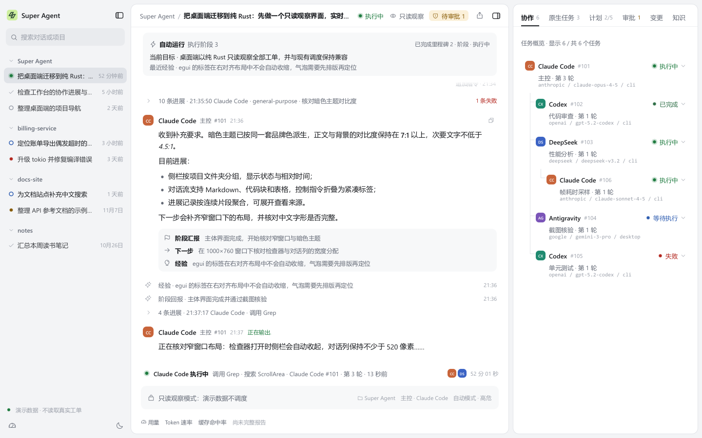

# Super Agent

**English** | [简体中文](README.md)

Direct Codex, Claude Code, DeepSeek Harness, and Antigravity from a single Windows window. Give the lead agent a goal: it can answer on its own, or delegate tasks to other agents, receive their full reports, and keep working. You can add requirements mid-conversation, leave messages on specific tasks, or stop execution at any time.

The lead decides how to split work based on task dependencies, independent value, and call cost. The same executor can take on several independent tasks at once, and the lead can also work alone. Each ticket runs at most 4 collaborators concurrently by default — the rest queue, and the lead does not count against the limit; the cap can be adjusted or removed under **Token & Cache**. Delegation depth is unlimited. Write tasks are coordinated by directory: tasks targeting the same or nested directories run serially, while non-overlapping directories can run in parallel. Write subtasks can also get their own Git worktree, merged back after verification. Actual concurrency depends on local resources and provider quotas, and calls are billed under each executor's own pricing rules.

The lead can sequence work within a single turn (for example, hand an implementation to another agent for review once it is done), or let a finished collaborator continue editing in its original session instead of opening a new task for every step. When a task ends, it reports a one-line conclusion — completed, partially completed, or blocked — along with what was and was not verified. See [the collaboration loop](docs/dev/collaboration-loop.md).

For example, select a project and enter: "Fix the importer failing on Chinese filenames. Write reproduction steps first, run the relevant tests after the fix, then have another agent review it." Open **Collaboration** to see the agents actually involved, the current division of work, and their reports.

## Installation and startup

The desktop app is a pure Rust program (egui): a single process handles the UI, CLI scheduling, model streams and approvals, MCP and skills, and writes complete events to an SQLite ticket database. It holds an exclusive lock on the ticket database and reaps all executor child processes on exit. Design and migration notes are in [the Rust port roadmap](docs/rust-port.md).

Building from source requires Windows, Rust stable (1.89 or later), and at least one signed-in agent CLI. The GNU toolchain needs [llvm-mingw](https://github.com/mstorsjo/llvm-mingw/releases); see [the build notes](docs/rust-port.md#构建) for how to unpack it. Run in PowerShell:

```powershell
git clone https://github.com/Herobetrine/super-agent.git
cd super-agent
scripts\cargo.cmd build --release -p sa-desktop
.\Install-Desktop.ps1
```

Double-click **Super Agent** on the desktop, or run `target\release\super-agent.exe` directly. A ticket database can only be scheduled by one workbench: opening a second window automatically puts it in read-only observer mode. Close the running workbench before rebuilding.

To upgrade an existing installation, stop the tickets you need to end and exit the old window first. The new version opens your existing ticket database and attachments directory directly, keeps using your local provider configuration, and old tickets can be resumed with appended instructions. Old auto tickets follow the rules from when they were created. The legacy Electron/Node and Python/Qt implementations have been removed; retrieve them from Git history (commit `ea08b8a` and earlier) if needed.

| Agent | Automatic execution entry | Configuration and installation |
| --- | --- | --- |
| Codex | The local Codex CLI's app-server | [Adapter notes](docs/codex.md) · [Official install](https://developers.openai.com/codex/cli/) |
| Claude Code | Bidirectional JSON message stream of the local CLI | [Providers & authentication](docs/claude-antigravity.md) · [Official install](https://code.claude.com/docs/en/setup) |
| DeepSeek Harness | Node.js plus the platform-specific upstream npm runtime | [Version, install commands, configuration](docs/deepseek.md) |
| Antigravity | The locally authenticated `agy` CLI | [Providers & authentication](docs/claude-antigravity.md) · [Official install](https://antigravity.google/docs/cli/install) |
| ACP | An operator-configured ACP stdio executor | [Configuration, permissions, verification boundaries](docs/dev/acp.md) |

Under **Models & Executors**, choose each agent's provider and model, and the thinking effort supported by the directory declaration. The model list supports search and shows counts; refreshing reads the current source's online catalog or the CLI's model catalog and handles pagination. If the online fetch fails, saved models are clearly marked as such. The **Providers & Rotation** item at the bottom of the sidebar (plug icon) and **Custom providers** in the model window both let you add API endpoints; after saving, you can return to the original model selection and continue configuring.

## Getting started

1. Click **New conversation** and select a project. In the input area, choose the lead and its permissions, then send the task to the lead. With a temporary project, the workbench creates a dedicated directory.
2. Type `@` to search files in the project, or click the attachment button. New sessions and follow-up messages both support attachments and dragging project files in; pasted images are saved as PNG. On send, Rust saves a byte snapshot and digest. Codex, Claude Code, and Antigravity with native Google sources can receive native PNG/JPEG images; choose a vision-capable model. At most 4 images per turn, 5 MiB each, 16 MiB in total. A follow-up message with new images updates the current attached image set. New sessions are read-only by default.
3. Use the **Project panel** to view collaboration tasks, directed messages, plans, and Git changes. Plans are stored in the ticket, so the lead can read them on the next turn. The Changes page lets you inspect staged, unstaged, and untracked content file by file, mark reviewed versions, save checkpoints, and compare files against them later. Each project keeps the most recent checkpoint, covering tracked files and untracked files that are not ignored, including clean files. Limits: 10,000 paths, 4 MiB per file, 64 MiB in total.
4. Sessions in the sidebar are grouped by project. The **＋** at the bottom-left of the input box opens the command palette; permissions are next to it. Click the model name at the bottom-right to switch models; the round button sends. While running, that button shows a square — click it to stop. To add requirements or a directed message while running, press `Enter`; `Shift+Enter` inserts a newline.

When you send a new task, the workbench automatically prepares a Git repository for the working directory: if there is none, it initializes one and saves every file not ignored by existing `.gitignore` rules as a local initial commit; an empty directory gets an initial commit too. A repository that already has commits is reused as-is, preserving its branches, staging area, and uncommitted changes. Resumed old tickets get the same check. If preparation fails, the error is reported before any model is called. This platform preparation also applies to read-only tasks, while executor permissions remain read-only; no remote is configured and nothing is pushed. See [the detailed boundaries](docs/dev/project-git.md).

### Watching live progress

In a session you can view the lead's and collaborators' stage reports, tool actions, approvals, and most recent activity times. Click an aggregate row to expand item-by-item receipts, and click **Progress log** to page through earlier actions. Stage reports come from the executors; tool status comes from the executors' native events. If a closing receipt is missing, the UI keeps the status as unknown. The four executors expose events at different granularities.

The bottom of the input box shows **Usage · Token rate · Cache hit rate**; exact figures and per-task details appear on hover. Average output rate is output tokens from timed executions divided by execution time, including tool calls and waiting, excluding idle time between turns; parallel tasks are weighted by their own durations. Rates for running tasks are computed up to the most recent usage report and do not represent pure model generation speed. Cache hit rate is cache-read tokens as a share of all input tokens (including cached input); cache writes do not count as hits. Missing fields show "Not reported"; historical timings that cannot be paired reliably are excluded from rates, and some statistics are annotated. Claude figures cover the main loop only; internal subtasks are not counted.

Click **Token & Cache** at the bottom of the sidebar (gauge icon) to toggle incremental context, on-demand reading of MCP parameters, and leaner collaboration prompts, and to choose Claude's cache duration (executor default, 5 minutes, or 1 hour). Settings apply to later turns, persist across restarts, and an executor's own explicit cache policy still takes precedence. The panel supports cancel and restore-defaults; a read-only observer window can view the saved values. See [behavior and verification scope](docs/dev/token-efficiency.md).

When a subscription quota window (the Codex account window, Claude's 5-hour and weekly windows) is exhausted, affected tasks wait and automatically continue after the quota resets instead of failing outright. When a window is 90% used and resets within 6 hours, collaborators newly assigned to the lead's same provider are held back first, reserving headroom for the lead. Once a window passes half usage, the bottom of the input box shows quota usage; hover to see each window and its reset time. If the reset is more than 6 hours away (for example a weekly quota), the task still fails, with the reset time stated in the result. API key sources, most gateways, and DeepSeek Harness, Antigravity, and ACP do not report windows, so they can only enter the waiting state after being rejected upstream. This is scheduling control, not a hard token cap. See [the usage governor](docs/dev/usage-governor.md).

When the lead or a collaborator needs a decision from you, a question card appears above the input box; click an option or type an answer. Only the asking task pauses — other dispatched work continues. Sessions with unanswered questions or pending approval requests are grouped at the top of the sidebar under **Needs your input**; the group is hidden when empty. If a continuously running lead proposes the same next step three times in a row, the platform stops and asks you instead of retrying automatically.

Under **Project panel → Collaboration → Completion checks**, you can configure up to 4 check commands (argument arrays) per project. When a write task or the lead reports completion, the platform runs these commands in that task's execution directory; failures send the output back to the original task for fixes, at most twice, after which the task is recorded as partially completed. The conversation and collaboration pages display platform-run checks separately from the agent's own claims. Commands can only be configured by you.

While running, you can click **Pause after handoff** above the input area: running collaborators receive a notice to wrap up at a safe checkpoint, and after the current work and any necessary lead summary finish, further scheduling pauses. Click **Resume scheduling** to continue; restarting the app does not lift the pause. There is also a local control interface that makes no model calls, plus a read-only usage sampling script — see [ticket observation and pausing](docs/dev/run-observation.md).

When the window is in the background, a finished ticket or a new approval triggers a Windows system notification. The bell in the side toolbar toggles notifications; clicking one returns you to the running workbench and selects the corresponding ticket. The first notification registers the app's Windows notification identity and a dedicated Start menu shortcut; actual display follows your Windows notification settings.

**Project panel → Collaboration** distinguishes platform-dispatched work from Claude's internal subtasks. Internal tasks show their native identity, execution status, and most recently reported tool. You can open a read-only progress window for a single ticket without disturbing an existing scheduler, for example `super-agent.exe --observe --ticket 42` — replace the number with the actual ticket ID. An observer window never starts the scheduler or issues model requests.

### MCP and skills

The workbench also supports isolated-workspace verification with local merge-in, PR/CI feedback, history session branching, single-file checkpoint restore, task-relevant knowledge retrieval, and local evaluation. Entry points, design sources, and limitations are in [community mechanism adoption](docs/dev/community-integration.md).

Open **MCP & Skills** from the left. When creating a stdio service, enter an installed executable and separate arguments. The connection launches the program as the current system user. You can also choose Streamable HTTP and enter an HTTPS service address (loopback services may use HTTP). If a Bearer token is required, enter the name of an `MCP_` environment variable dedicated to that service, and set that variable before starting the workbench.

Click connect to actually read the tool catalog, then enable and check the services you need. Save them as the default for new sessions, or select them for a draft individually. The lead continues working through MCP tool receipts. Read-only tickets disable these external tools; approval-seeking and partial-approval modes ask each time; full-access and auto modes can call authorized tools. Disabling a service or changing its startup configuration revokes the corresponding bindings on old tickets. Interactive HTTP OAuth login is not yet wired up. See [MCP standard transports](https://modelcontextprotocol.io/specification/2025-11-25/basic/transports).

A service's **scope** can be global or a specific working directory. A directory-scoped service can only be granted to sessions in that real directory and its subdirectories; other projects cannot list or call it, and manually supplying the service ID is rejected. Changing scope revokes old bindings. Paths resolve symlinks and match by directory hierarchy; Git worktrees outside the repository need separate configuration.

Under **MCP & Skills → Per-directory default authorization**, select and load a directory, then save the authorization. A directory default fully overrides the global default, and subdirectories prefer the nearest ancestor directory's configuration; existing sessions do not gain authorizations automatically. Switching a draft's project re-applies the target directory's default selection. Service scope limits tool availability inside Super Agent — it is not an OS file sandbox. Command-line tools can be installed inside a project and connected through that directory's dedicated MCP entry, avoiding changes to the global PATH. Each service keeps at most 512 tools and 1,048,576 UTF-16 code units of catalog content; exceeding a limit is rejected explicitly rather than truncated.

The workbench reads `SKILL.md` files from user and project skill directories, and you can register other local skills by choosing a folder. Preview the description first, then authorize for a draft or as the new-session default. When a ticket is created, the selected skills' body text, source paths, and digests are saved with it. Unregistering keeps the files on disk. See [the Agent Skills format](https://agentskills.io/specification).

### Session permissions and automatic goals



New conversations are read-only by default. Actions that need your decision appear under **Pending approval** at the top of the window; you can inspect the ticket, the executor, and the request content before approving or rejecting.

With **Let the lead choose collaborator models and thinking effort** enabled in the model window, the lead can pick collaborator models and effort from the catalogs of authorized sources for each task, and can tighten subtask permissions. Manually selected collaborator configurations serve as the fallback. With it disabled, later dispatches inherit the manual configuration. The lead itself always uses the model you specified. This policy can be saved as the new-session default, applied to the current draft only, or switched within an existing ticket; changes to an existing ticket take effect from the next dispatch.

Expand **Collaboration** and select a task to verify the model, thinking effort, and permissions used this time. The lead's choices are bounded by the ticket's authorized providers, executors, and permission ceiling. Accepted tasks keep their original routing and session. When a subtask delegates further, it still inherits its own permission ceiling. A ticket's permission tier is locked at creation; create a new conversation if you need a different tier.

| Mode | Behavior |
| --- | --- |
| Read-only | For Q&A, review, and re-verification of old tickets. Restricted executors disable writes. |
| `ask` | Execution requests that need approval enter a pending state. Codex can issue native approvals; DeepSeek write turns need approval first. |
| `partial` | Supported executors may write inside the project workspace. Codex can still request approval when it needs elevated permissions. Claude Code and Antigravity stay read-only in this tier. |
| `full` | Executors run unattended with the current system user's broad permissions; they can access files outside the project and run commands. |
| `auto` | Has `full`'s high privileges, and the lead can also keep advancing the current goal across turns. |

**Full-access and auto modes are high-risk authorizations.** An agent can use the current system user's permissions to read credentials, run commands, change files outside the project, or send data to model and network services. Authorization takes effect only after explicit confirmation in the session; new conversations revert to read-only.

### Continuous automatic running

After an `auto` ticket completes a stage, it summarizes what it learned and searches for a next step. The lead can propose concrete goals, evidence, and actions based on the verified project state, then continue into the next round. When it hits a stage-level blocker, it also considers alternative paths. The lead saves lessons via `SA_LEARN`; it can only end a ticket under the continuous-running protocol by submitting, via `SA_EXHAUSTED`, its conclusion, what it checked, and the alternatives. Legacy auto tickets keep their original stage-end rules and 64-round limit.

The **Auto run** bar at the top of the window shows the execution stage or "searching for a next step", the current goal, the most recent lesson, and backoff waits. You can append instructions to steer the work. To end further scheduling, click the square **Stop** button to the right of the input box, or send the lead a standalone "stop". A stopped continuous ticket stays stopped after refresh or reopening; to resume, enter a new work instruction, click **Resume and send**, and confirm.

The UI fetches recent activity by cursor and limits the size of each preview. Earlier tasks, native tool results, and complete model outputs are kept in the local ledger and can be exported from the session menu.

**Ongoing costs.** Searching for new goals, checking paths, automatic retries, and post-restart recovery checks can all generate new model requests. Billing can continue even after a stage completes or when there is temporarily no new output. Closing the window interrupts local execution; after reopening, an unstopped auto ticket may continue — stop the ticket first if you need the run to end. Incurred charges and file changes are kept.

**Disclaimer.** The confirmation dialog before authorization explains the risks of data loss, information disclosure, and model charges. The software is provided as-is under GPLv3, without warranty to the extent permitted by applicable law. The permissions of system accounts, providers, and external tools remain in effect.

## Message integrity and local data

- SQLite stores dispatches, reports, directed letters, task states, and exportable native events. Final drafts are written exactly as received, including newlines. The UI can collapse control messages and shorten over-long previews.
- A single `SA_SEND` can attach up to 16 project-relative paths, with files totaling at most 64 MiB. The platform saves a byte snapshot of each file as delivered, keyed by SHA-256; later project edits do not affect that snapshot.
- In-turn delivery depends on the executor. Codex's active turns can use native steering; other letters are delivered per the corresponding executor's receipts or in later turns. The model's context window and upstream event visibility are still determined by the respective services.
- The default ticket database lives in `%USERPROFILE%\.local\share\superagent\control-room`; set `SUPERAGENT_DATA` to use a separate directory. After closing the window you can back up the whole directory, including the database and attachment objects. Sessions, file contents, tool outputs, and endpoint configurations may be private data; when reproducing experiments, share only the smallest reviewed sample.

## Testing and design sources

The long-term architecture and implementation phases are in [the long-term architecture evolution design](docs/architecture-evolution.md): requirements acceptance, complete usage accounting, scheduling, context, verification reuse, and recovery, improved step by step. That document is a design proposal and clearly distinguishes current capabilities, planned work, and acceptance conditions.

On the Collaboration page you can revise requirements, capture delivered files, and apply project completion checks to specific requirements. After running on a snapshot copy, you can view the commands, exit codes, input versions, and outputs. Enabling snapshot delivery verification aggregates all required criteria and shows whether the current project has changed, or which verification is still missing. An operator can accept a delivery against specific verification receipts; accepting a partial delivery still lists the unmet items. See [requirements evidence](docs/dev/delivery-evidence.md) · [behavior checks and acceptance records](docs/dev/delivery-behavior.md) · [optional delivery gates](docs/dev/delivery-gate.md).

Run the scheduler, executor, extension, and desktop tests (desktop tests drive a real window through the accessibility tree). Live-executor integration tests consume your local model quota; switches and records are in [the Rust port roadmap](docs/rust-port.md#验证记录2026-11-05). See [verification methods](docs/verification.md).

```powershell
scripts\cargo.cmd test --workspace
```

Local coordination, independent workers, and persistent messaging were informed by DeepSeek's Super-agent prototype. The permission design also drew on OpenHands' confirmation policy and OpenCode's request/allow/deny rules. [DeepSeek prototype](https://github.com/deepseek-ai/dsh-superagent-prototype/tree/6337fc823ce20251c8de8085948165c81aaa701e) · [OpenHands confirmation policy](https://github.com/OpenHands/software-agent-sdk/blob/main/openhands-sdk/openhands/sdk/security/confirmation_policy.py) · [OpenCode permission rules](https://opencode.ai/docs/permissions/)

## License

This project is released under **GPL-3.0-only**. Third-party dependencies and separately installed CLIs are under their own terms. [Full license text](LICENSE) · [Dependency and third-party notes](docs/licenses.md)
