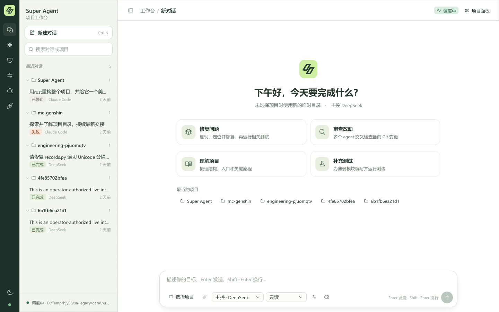

# Super Agent

在一个 Windows 窗口里指挥 Codex、Claude Code、DeepSeek Harness 和 Antigravity。向主控提出目标，它可以自己回答，也可以分派任务、接收其他 agent 的完整回报，再继续工作。你可以在对话中补充要求、给具体任务留言或停止执行。

主控根据任务依赖、独立收益和调用成本决定如何分工。同一种执行端可以同时承担多个独立任务，主控也可以独自完成。调度器不设协作者总数、每种执行端的人数、只读并发数或委派层数上限。写入任务按目录协调：相同或嵌套目录串行，不重叠目录可以并行。还可为后续写入子任务开启独立 Git 工作区，验证后再合入。实际并发受本机资源和供应商配额影响，调用按各执行端的计费规则计算。

例如，选中项目后输入「修复导入器无法处理中文文件名的问题。先写出复现步骤，修改后运行相关测试，再请另一个 agent 审查」。打开 **协作** 可看到实际参与的 agent、当前分工和回报。

## 安装与启动

桌面端是纯 Rust 程序（egui）：同一个进程负责界面、调度 CLI、处理模型流与审批、MCP 与技能，并把完整事件写入 SQLite 工单库；它持有工单库的独占锁，退出时回收全部执行端子进程。设计与迁移记录见 [Rust 重构路线](docs/rust-port.md)。

从源码构建需要 Windows、Rust stable（1.89 或更高版本）和至少一个已登录的 agent CLI。GNU 工具链需要 [llvm-mingw](https://github.com/mstorsjo/llvm-mingw/releases)，解压方式见 [构建说明](docs/rust-port.md#构建)。在 PowerShell 执行以下命令。

```powershell
git clone https://github.com/Herobetrine/super-agent.git
cd super-agent
scripts\cargo.cmd build --release -p sa-desktop
.\Install-Desktop.ps1
```

双击桌面的 **Super Agent**，也可以直接运行 `target\release\super-agent.exe`。同一个工单库只能由一个工作台调度；再打开一个窗口时，新窗口自动以只读观察模式打开。重建前先关闭运行中的工作台。

升级已有安装时，先停止需要终止的工单并退出旧窗口。新版直接打开原工单库和附件目录，继续使用本机供应商配置；旧工单可以追加指令续跑。旧自动工单遵守创建时的规则。旧版 Electron/Node 与 Python/Qt 实现已移除，需要时可从 Git 历史（提交 `ea08b8a` 及之前）取回。

| Agent | 自动执行入口 | 配置和安装 |
| --- | --- | --- |
| Codex | 本机 Codex CLI 的 app-server | [适配说明](docs/codex.md) · [官方安装](https://developers.openai.com/codex/cli/) |
| Claude Code | 本机 CLI 的双向 JSON 消息流 | [供应商与认证](docs/claude-antigravity.md) · [官方安装](https://code.claude.com/docs/en/setup) |
| DeepSeek Harness | Node.js 及平台专用的上游 npm 运行时 | [版本、安装命令和配置](docs/deepseek.md) |
| Antigravity | 本机已认证的 `agy` CLI | [供应商与认证](docs/claude-antigravity.md) · [官方安装](https://antigravity.google/docs/cli/install) |
| ACP | 操作员配置的 ACP stdio 执行端 | [配置、权限与验证边界](docs/dev/acp.md) |

在 **模型与执行端** 中为每个 agent 选择供应商、模型与目录声明支持的思考强度。模型列表支持搜索和数量显示，刷新会读取当前来源的在线目录或 CLI 模型目录，并处理分页。在线获取失败时会明确标注已保存型号。侧栏 **管理自定义供应商** 和模型窗口中的 **自定义供应商** 都可添加 API 端点，保存后可返回原模型选择继续配置。

## 开始工作

1. 点击 **新建对话**，选择项目。在输入区选主控和权限，将任务发给主控。使用临时项目时，工作台会创建独立目录。
2. 输入 `@` 搜索项目内文件，或点击附件按钮。新会话和后续消息都支持附件及拖入项目文件，粘贴图片会保存为 PNG。发送时 Rust 保存字节快照和摘要。Codex 与 Claude Code 可接收原生 PNG/JPEG 图片，需要选择支持视觉的模型，每轮最多 4 张、每张 5 MiB、合计 16 MiB。后续消息带新图时更新当前附加图片集。新会话默认只读。
3. 在 **项目面板** 查看协作任务、定向留言、计划和 Git 变更。计划保存在工单里，下一轮主控可以读取。变更页可逐文件查看暂存、未暂存和未跟踪内容，标记已审阅版本，并保存检查点与后续文件比较。每项目保留最近检查点，覆盖已跟踪文件及未被忽略的未跟踪文件，包括清洁文件。上限为 10000 个路径、单文件 4 MiB、总计 64 MiB。
4. 左侧会话按项目归组。输入框左下角的 **＋** 打开命令面板，旁边是权限。右下角点击模型名选型，圆形按钮发送。运行时该按钮显示方块，点击停止；要继续补充要求或定向留言，按 `Enter`，`Shift+Enter` 换行。

### 查看实时进展

在会话中可直接查看主控与协作者的阶段汇报、工具操作、审批和最近活动时间。点击聚合行展开逐项回执，点击 **进展记录** 翻看较早的操作。阶段汇报来自执行者，工具状态来自执行端的原生事件。缺少结束回执时界面保留未知状态。四个执行端暴露的事件粒度各不相同。

输入框底部显示 **用量 · Token 速率 · 缓存命中率**，鼠标悬停时才展示精确数字及各任务详情。平均输出速率按可计时执行的输出 Token 除以执行耗时计算，包含工具调用和等待，排除轮次间空闲；并行任务按各自耗时加权。执行中的速率统计截至最近一次用量报告，不代表模型纯生成速度。缓存命中率为缓存读取 Token 占全部输入（含缓存）的比例，缓存写入不算命中。缺失字段显示“未报告”，无法可靠配对的历史计时不参与速率，部分统计会注明。Claude 仅统计主循环，内部子任务未计入。

点击侧栏底部 **Token 与缓存**，可开关增量上下文、精简协作提示，并选择 Claude 缓存时长（沿用执行端、5 分钟或 1 小时）。保存后用于后续轮次，重启后保留；执行端已有的显式缓存策略仍优先。面板支持取消和恢复默认，只读观察窗口可查看已保存值。[行为与验证范围](docs/dev/token-efficiency.md)

窗口在后台时，工单结束或产生新审批会触发 Windows 系统通知。侧边工具栏的铃铛可开关通知，点击通知可回到运行中的工作台并选择对应工单。首次发送会登记本应用的 Windows 通知身份及专属开始菜单快捷方式，实际显示遵循 Windows 通知设置。

**项目面板 → 协作** 区分平台派工和 Claude 内部子任务。内部任务显示原生身份、执行状态及最近报告的工具。可以在不打断已有调度器时单独打开某张工单的只读进展窗口，例如 `super-agent.exe --observe --ticket 42`；将数字替换成实际工单号。观察窗口不会启动调度器或发出模型请求。

### MCP 与技能

工作台还支持隔离工作区验证与本地合入、PR/CI 反馈、历史会话分支、单文件检查点恢复、任务相关知识检索和本地评测。具体入口、设计来源及限制见 [社区机制吸纳](docs/dev/community-integration.md)。

从左侧打开 **MCP 与技能**。新建 stdio 服务时填写已安装的可执行程序和独立参数。连接会以当前系统用户身份启动该程序。也可选 Streamable HTTP，填写 HTTPS 服务地址（回环服务可用 HTTP）。需要 Bearer 令牌时，填写专用于该服务的 `MCP_` 环境变量名称。在启动工作台前设置该变量。

点击连接以实际读取工具目录，启用并勾选所需服务。可保存为新会话默认，或为草稿单独选择。主控通过 MCP 工具回执继续工作。只读工单禁用这些外部工具，寻求审批和部分审批逐次询问，完全访问和自动模式可以调用已授权的工具。禁用服务或改变启动配置会撤销旧工单的对应绑定。HTTP OAuth 交互登录尚未接入。[MCP 标准传输](https://modelcontextprotocol.io/specification/2025-11-25/basic/transports)

服务的 **适用范围** 可选全局或指定工作目录。指定目录的服务只可授予该真实目录及其子目录中的会话；其他项目不能列出或调用它，即使手动提供服务 ID 也会被拒绝。范围变更会撤销旧绑定。路径会解析符号链接，并按目录层级匹配；仓外 Git 工作区需要独立配置。

在 **MCP 与技能 → 工作目录默认授权** 中选择并载入目录，再保存授权。目录默认完整覆盖全局默认，子目录优先使用最近祖先目录的配置；已有会话不会自动增加授权。切换草稿项目会重新使用目标目录的默认选择。服务范围限制的是 Super Agent 的工具可用性，不是操作系统文件沙箱；命令行工具可安装在项目内，并通过该目录专用的 MCP 入口接入，避免修改全局 PATH。每个服务最多保留 512 个工具和 1,048,576 个 UTF-16 单位的目录内容，超限会明确拒绝而不截断。

工作台读取用户和项目技能目录中的 `SKILL.md`，也可通过选择文件夹登记其他本机技能。先预览说明，再为草稿或新会话默认授权。创建工单时保存所选技能的正文、来源路径和摘要。取消登记保留磁盘文件。[Agent Skills 格式](https://agentskills.io/specification)

### 会话权限与自动目标



新对话默认只读。需要你决定的动作出现在窗口顶部的 **待审批** 中，可检查工单、执行者和请求内容后批准或拒绝。

在模型窗口打开 **交给主控选择协作者模型和思考强度** 后，主控可按任务从获准来源的目录中选择协作者模型和强度，并可收紧子任务权限。手动选定的协作者配置用于回退。关闭后，后续派工继承手动配置。主控自身始终使用你指定的模型。此策略可保存为新会话默认、仅用于当前草稿，或在已有工单中切换；已有工单的变更从后续派工生效。

展开 **协作** 并选中任务，可以核对本次使用的模型、思考强度和权限。主控的选择范围由工单授权的供应商、执行端及权限上限约束。已接受的任务沿用原路由与会话。子任务继续派工时仍继承自己的权限上限。工单级权限档位在创建后锁定，需要不同档位时请新建对话。

| 模式 | 行为 |
| --- | --- |
| 只读 | 用于问答、审查和旧工单复验。受限执行器禁用写入。 |
| `ask` | 需要批准的执行请求进入待处理状态。Codex 可以发出原生审批，DeepSeek 的写入轮次需要先获准。 |
| `partial` | 允许受支持执行器在项目工作区内写入。Codex 需要提升权限时仍可请求审批。Claude Code 和 Antigravity 在此档维持只读。 |
| `full` | 执行器以当前系统用户的广泛权限无人值守运行，可访问项目外文件并执行命令。 |
| `auto` | 具有 `full` 的高权限，主控还可跨轮持续推进当前目标。 |

**完全访问和自动模式均为高风险授权。** Agent 可以用当前系统用户的权限读取凭据、运行命令、改变项目外的文件，或把数据发送给模型和网络服务。在本次会话明确确认后授权才生效；新对话恢复为只读。

### 持续自动运行

新建的 `auto` 工单完成一个阶段后，会总结经验并搜寻下一步。主控可根据已验证的项目状态提出具体目标、证据和行动，继续下一轮。遇到阶段性阻塞时也会考虑替代路径。主控通过 `SA_LEARN` 保存经验；通过 `SA_EXHAUSTED` 提交结论、已核查事项和替代方案，才可按持续运行协议结束工单。旧版自动工单保留原有的阶段结束规则和 64 轮限制。

窗口顶部的**自动运行**栏显示执行阶段或“正在搜寻下一步”、当前目标、最近经验以及退避等待。你可以追加指令调整工作方向。要终止后续调度，点击输入框右侧的方形 **停止** 键，也可以给主控单独发送“停止”。已停止的持续工单在刷新或重开后保持停止状态；输入新的工作指令，点击 **恢复并发送** 并确认，才会继续。

界面按游标获取近期活动并限制单次预览大小。较早的任务、原生工具结果和完整模型输出保存在本地账本，可用会话菜单导出。

**持续费用。** 搜寻新目标、核查路径、自动重试以及重启后的恢复检查，都可能产生新的模型请求。已完成阶段和暂时没有新成果时也可能继续计费。关闭窗口会中断本机执行，重开后未停止的自动工单可能继续；需要结束运行时，请先停止工单。已产生的费用和文件变更保留。

**免责声明。** 授权前的确认框会说明数据丢失、信息外传和模型费用风险。软件按 GPLv3 以原样提供，在适用法律允许的范围内不提供担保。系统账户、供应商和外部工具的权限仍然生效。

## 消息完整性与本地数据

- SQLite 保存派工、回报、定向信件、任务状态及可导出的原生事件。完整终稿按收到的字符串写入，包括换行。界面可折叠控制消息并缩短过长的预览。
- 一个 `SA_SEND` 可附带最多 16 个项目相对路径，文件合计不超过 64 MiB。平台按 SHA-256 保存交付时的字节快照，后续项目修改不影响该份快照。
- 轮内接收取决于执行器。Codex 的活动轮次可使用原生 steering，其余信件按对应执行器的回执或后续轮次投递。模型的上下文窗口和上游事件可见性仍由相应服务决定。
- 默认工单库位于 `%USERPROFILE%\.local\share\superagent\control-room`，可用 `SUPERAGENT_DATA` 指定独立目录。关闭窗口后可备份整个目录，包括数据库和附件对象。会话、文件内容、工具输出和端点配置可能是私有数据；复现实验时可以只分享经过检查的最小样例。

## 测试与设计来源

运行调度器、执行端、扩展和桌面测试（桌面测试通过无障碍树驱动真实窗口）。真实执行器联测需使用本机模型配额，开关与记录见 [Rust 重构路线](docs/rust-port.md#验证记录2026-11-05)。[验证方法](docs/verification.md)

```powershell
scripts\cargo.cmd test --workspace
```


本地统筹、独立 worker 和持久化消息参考了 DeepSeek 的 Super-agent 原型。权限设计也参考了 OpenHands 的确认策略及 OpenCode 的请求、允许、拒绝规则。[DeepSeek 原型](https://github.com/deepseek-ai/dsh-superagent-prototype/tree/6337fc823ce20251c8de8085948165c81aaa701e) · [OpenHands 确认策略](https://github.com/OpenHands/software-agent-sdk/blob/main/openhands-sdk/openhands/sdk/security/confirmation_policy.py) · [OpenCode 权限规则](https://opencode.ai/docs/permissions/)

## 许可证

本项目按 **GPL-3.0-only** 发布。第三方依赖和单独安装的 CLI 适用各自条款。[许可证全文](LICENSE) · [依赖与第三方说明](docs/licenses.md)
