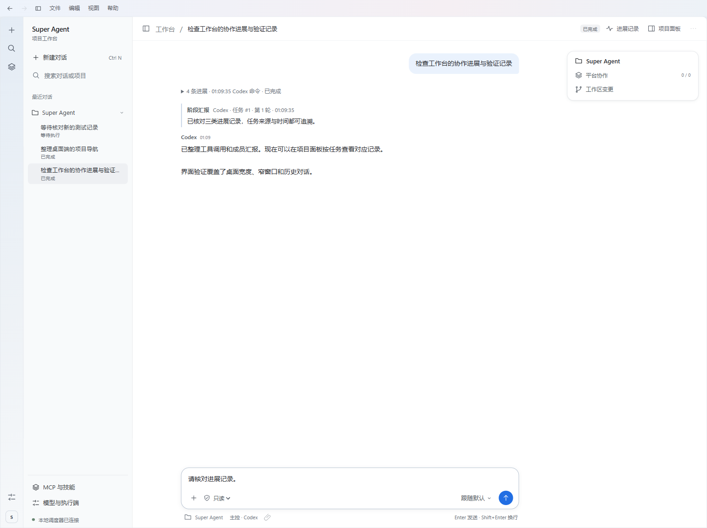

# Super Agent

在一个 Windows 窗口里指挥 Codex、Claude Code、DeepSeek Harness 和 Antigravity。向主控提出目标，它可以自己回答，也可以分派任务、接收其他 agent 的完整回报，再继续工作。你可以在对话中补充要求、给具体任务留言或停止执行。

主控根据任务依赖、独立收益和调用成本决定如何分工。同一种执行端可以同时承担多个独立任务，主控也可以独自完成。调度器不设协作者总数、每种执行端的人数、只读并发数或委派层数上限。声明为写入的任务按顺序执行。实际可同时运行的进程数受本机资源和供应商配额影响，调用按各执行端的计费规则计算。

例如，选中项目后输入「修复导入器无法处理中文文件名的问题。先写出复现步骤，修改后运行相关测试，再请另一个 agent 审查」。打开 **协作** 可看到实际参与的 agent、当前分工和回报。

## 安装与启动

桌面端使用 Electron。Node.js 子进程独立调度 CLI、处理模型流和审批，将完整事件写入 SQLite。Rust 服务负责项目文件检索、SHA-256 快照、长上下文归档，以及 Windows 工单库的独占锁和子进程回收。

从源码构建需要 Windows、Node.js 24 或更高版本、Rust stable（1.89 或更高版本）和至少一个已登录的 agent CLI。在 PowerShell 执行以下命令。

```powershell
git clone https://github.com/Herobetrine/super-agent.git
cd super-agent
npm ci
node node_modules/electron/install.js
npm run build:native
.\Install-Desktop.ps1
```

双击桌面的 **Super Agent**，也可以运行 `npm start`。在 Windows 使用 Rust MSVC 工具链时需要 Visual Studio C++ Build Tools。GNU 工具链需要可用的 MinGW binutils，使用独立 LLVM 的 `dlltool.exe` 时可通过 `SUPERAGENT_DLLTOOL` 指定路径。重建前先关闭运行中的工作台。[Rust Windows 安装说明](https://rust-lang.github.io/rustup/installation/windows.html)

升级已有安装时，先停止需要终止的工单并退出旧窗口。新版直接打开原工单库和附件目录，继续使用本机供应商配置。旧自动工单遵守创建时的规则。Python 和 Qt 源文件保留用于迁移对照及回归测试。

| Agent | 自动执行入口 | 配置和安装 |
| --- | --- | --- |
| Codex | 本机 Codex CLI 的 app-server | [适配说明](docs/codex.md) · [官方安装](https://developers.openai.com/codex/cli/) |
| Claude Code | 本机 CLI 的双向 JSON 消息流 | [供应商与认证](docs/claude-antigravity.md) · [官方安装](https://code.claude.com/docs/en/setup) |
| DeepSeek Harness | Node.js 及平台专用的上游 npm 运行时 | [版本、安装命令和配置](docs/deepseek.md) |
| Antigravity | 本机已认证的 `agy` CLI | [供应商与认证](docs/claude-antigravity.md) · [官方安装](https://antigravity.google/docs/cli/install) |

在 **模型与执行端** 中为每个 agent 选择供应商与模型。候选项来自本机配置或对应 CLI 的目录。可以跟随当前默认，也可以把当前组合固定在一张工单中。选中的供应商失效时，任务显示错误。界面只启用已打通自动投递、执行和回传的执行端。

## 开始工作

1. 点击 **新建对话**，选择项目。在输入区选主控和权限，将任务发给主控。使用临时项目时，工作台会创建独立目录。
2. 输入 `@` 搜索项目内文件，或点击附件按钮。发送时 Rust 保存所选文件的字节快照和摘要，并把清单交给主控。新会话默认只读。
3. 在 **项目面板** 查看协作任务、定向留言、计划和 Git 变更。计划保存在工单里，下一轮主控可以读取。变更页区分暂存、未暂存及未跟踪文件状态。
4. 左侧会话按项目归组。输入框左下角的 **＋** 打开命令面板，旁边是权限。右下角点击模型名选型，圆形按钮发送。运行时该按钮显示方块，点击停止；要继续补充要求或定向留言，按 `Enter`，`Shift+Enter` 换行。

### 查看实时进展

在会话中可直接查看主控与协作者的阶段汇报、工具操作、审批和最近活动时间。点击聚合行展开逐项回执，点击 **进展记录** 翻看较早的操作。阶段汇报来自执行者，工具状态来自执行端的原生事件。缺少结束回执时界面保留未知状态。四个执行端暴露的事件粒度各不相同。

**项目面板 → 协作** 区分平台派工和 Claude 内部子任务。内部任务显示原生身份、执行状态及最近报告的工具。可以在不打断已有调度器时单独打开某张工单的只读进展窗口，例如 `npm start -- --observe=42`；将数字替换成实际工单号。观察窗口不会启动调度器或发出模型请求。

### MCP 与技能

从左侧打开 **MCP 与技能**。新建 stdio 服务时填写已安装的可执行程序和独立参数。连接会以当前系统用户身份启动该程序。也可选 Streamable HTTP，填写 HTTPS 服务地址（回环服务可用 HTTP）。需要 Bearer 令牌时，填写专用于该服务的 `MCP_` 环境变量名称。在启动工作台前设置该变量。

点击连接以实际读取工具目录，启用并勾选所需服务。可保存为新会话默认，或为草稿单独选择。主控通过 MCP 工具回执继续工作。只读工单禁用这些外部工具，寻求审批和部分审批逐次询问，完全访问和自动模式可以调用已授权的工具。禁用服务或改变启动配置会撤销旧工单的对应绑定。HTTP OAuth 交互登录尚未接入。[MCP 标准传输](https://modelcontextprotocol.io/specification/2025-11-25/basic/transports)

工作台读取用户和项目技能目录中的 `SKILL.md`，也可通过选择文件夹登记其他本机技能。先预览说明，再为草稿或新会话默认授权。创建工单时保存所选技能的正文、来源路径和摘要。取消登记保留磁盘文件。[Agent Skills 格式](https://agentskills.io/specification)

### 会话权限与自动目标



新对话默认只读。需要你决定的动作出现在窗口顶部的 **待审批** 中，可检查工单、执行者和请求内容后批准或拒绝。

新对话默认允许主控为每个子任务选模型、分配职能并收紧权限。主控会从目标 agent 当前获准的供应商与执行端中读取可选模型，按任务从中选择。要坚持使用原先配置的模型，请在发送首条消息前点 **主控**，关闭 **允许主控为协作者选择模型和子任务权限**。

展开 **协作** 并选中任务，可以核对本次使用的模型和权限。主控不能替工单切换供应商，也不能给子任务授予超出工单档位的权限。子任务继续派工时仍继承自己的权限上限。已开始的工单锁定原授权，需要不同的工单级权限时请新建对话。

| 模式 | 行为 |
| --- | --- |
| 只读 | 用于问答、审查和旧工单复验。受限执行器禁用写入。 |
| `ask` | 需要批准的执行请求进入待处理状态。Codex 可以发出原生审批，DeepSeek 的写入轮次需要先获准。 |
| `partial` | 允许受支持执行器在项目工作区内写入。Codex 需要提升权限时仍可请求审批。Claude Code 和 Antigravity 在此档维持只读。 |
| `full` | 执行器以当前系统用户的广泛权限无人值守运行，可访问项目外文件并执行命令。 |
| `auto` | 具有 `full` 的高权限，主控还可跨轮持续推进当前目标。 |

**完全访问和自动模式均为高风险授权。** Agent 可以用当前系统用户的权限读取凭据、运行命令、改变项目外的文件，或把数据发送给模型和网络服务。在本次会话明确确认后授权才生效；新对话恢复为只读。

### 持续自动运行

新建的 `auto` 工单完成一个阶段后，会总结经验并搜寻下一步。主控可根据已验证的项目状态提出具体目标、证据和行动，继续下一轮。遇到阶段性阻塞时也会考虑替代路径。主控通过 `SA_LEARN` 保存经验；通过 `SA_EXHAUSTED` 提交结论、已核查事项和替代方案，才可按持续运行协议结束工单。旧版自动工单保留原有的阶段结束规则和 64 轮限制。

窗口顶部的**自动运行**栏显示执行阶段或“正在搜寻下一步”、当前目标、最近经验以及退避等待。你可以追加指令调整工作方向。要终止后续调度，点击输入框右侧的方形 **停止** 键，也可以给主控单独发送“停止”。已停止的持续工单在刷新或重开后保持停止状态；输入新的工作指令，点击 **恢复并发送** 并确认，才会继续。

界面按游标获取近期活动并限制单次预览大小。较早的任务、原生工具结果和完整模型输出保存在本地账本，可用会话菜单导出。

**持续费用。** 搜寻新目标、核查路径、自动重试以及重启后的恢复检查，都可能产生新的模型请求。已完成阶段和暂时没有新成果时也可能继续计费。关闭窗口会中断本机执行，重开后未停止的自动工单可能继续；需要结束运行时，请先停止工单。已产生的费用和文件变更保留。

**免责声明。** 授权前的确认框会说明数据丢失、信息外传和模型费用风险。软件按 GPLv3 以原样提供，在适用法律允许的范围内不提供担保。系统账户、供应商和外部工具的权限仍然生效。

## 消息完整性与本地数据

- SQLite 保存派工、回报、定向信件、任务状态及可导出的原生事件。完整终稿按收到的字符串写入，包括换行。界面可折叠控制消息并缩短过长的预览。
- 一个 `SA_SEND` 可附带最多 16 个项目相对路径，文件合计不超过 64 MiB。平台按 SHA-256 保存交付时的字节快照，后续项目修改不影响该份快照。
- 轮内接收取决于执行器。Codex 的活动轮次可使用原生 steering，其余信件按对应执行器的回执或后续轮次投递。模型的上下文窗口和上游事件可见性仍由相应服务决定。
- 默认工单库位于 `%USERPROFILE%\.local\share\superagent\control-room`，可用 `SUPERAGENT_DATA` 指定独立目录。关闭窗口后可备份整个目录，包括数据库和附件对象。会话、文件内容、工具输出和端点配置可能是私有数据；复现实验时可以只分享经过检查的最小样例。

## 测试与设计来源

运行原生层、调度器、扩展和桌面测试。真实执行器联测需使用本机模型配额。[验证方法](docs/verification.md)

```powershell
npm run build:native
npm test
```

本地统筹、独立 worker 和持久化消息参考了 DeepSeek 的 Super-agent 原型。权限设计也参考了 OpenHands 的确认策略及 OpenCode 的请求、允许、拒绝规则。[DeepSeek 原型](https://github.com/deepseek-ai/dsh-superagent-prototype/tree/6337fc823ce20251c8de8085948165c81aaa701e) · [OpenHands 确认策略](https://github.com/OpenHands/software-agent-sdk/blob/main/openhands-sdk/openhands/sdk/security/confirmation_policy.py) · [OpenCode 权限规则](https://opencode.ai/docs/permissions/)

## 许可证

本项目按 **GPL-3.0-only** 发布。第三方依赖和单独安装的 CLI 适用各自条款。[许可证全文](LICENSE) · [依赖与第三方说明](docs/licenses.md)
