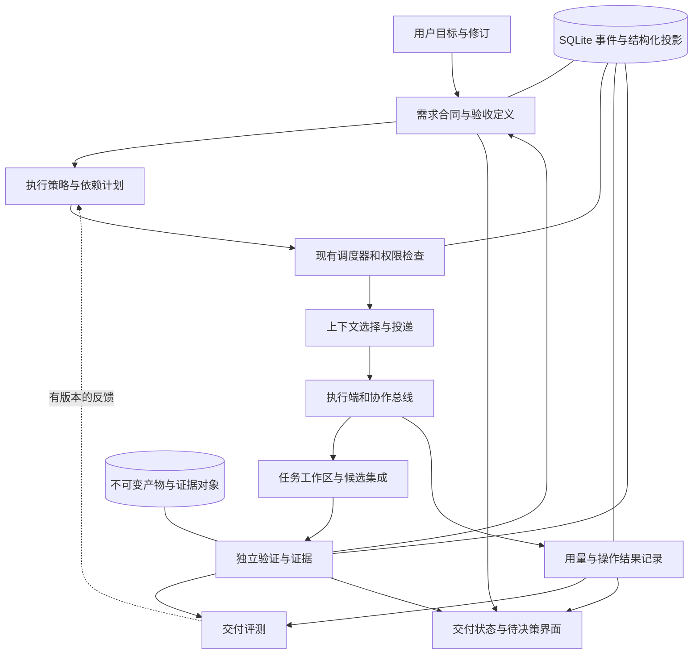

# Super Agent 长期架构演进设计

状态：设计提案 v0.1；用于后续分阶段开发，不代表以下能力已经实现或验收。  
实施进度：2026-11-18 起，P0A–P5 的实现已全部接入，各阶段的范围、验证和未完成项见 [§14.2](#142-实施状态2026-11-18)。阶段出口要求的代表性真实运行和人工验收尚未进行，因此还没有阶段正式关闭。开发验证见[验证记录](verification.md)。  
编写日期：2026-11-17。  
基线：本地 Rust 工作区，Git HEAD `0cc3b8b8d25ac9ed06bafa61a69e0458ebc13bed`，包含当前尚未提交的协作闭环、候选队列及自动 Git 准备改动。HEAD 单独不能复现整个基线；实施各阶段前必须冻结源码及配置版本。  
范围：Windows 本地桌面工作台及其调度、账本、执行端适配、协作总线、扩展和评测。本文不授权启动任何开发阶段、付费评测、远端发布或变更现有工单策略。

## 1. 原始目标与设计结论

用户在会话导出文档《SuperAgent 架构优化.md》开头提出六项产品目标：协作效率更高、交互体验更舒适、agent 功能更全面、多数情况下更自主、产出质量更高，同时降低用量消耗。原文随后关于 Fable 担任顾问和统筹、控制代理数量及避免额度耗尽的要求，属于当时的执行方式约束；不能用完成额度控制器来替代六项产品目标。

本设计围绕一个闭环组织系统：**记录用户要什么，选择合适的执行方式，保存实际交付与验证证据，再根据质量、用量、时间和人工投入调整后续执行。**

核心决策：继续扩展现有 Rust、SQLite、Git worktree 和执行端适配架构；首先建立版本化需求与验收证据，以及完整且可解释的用量记录。后续的自适应调度、上下文筛选、验证复用和故障恢复均依赖这些基础。暂不引入新的中心服务、图运行时或必需的云端分析平台。

“更低用量”需要在相同任务和质量要求下验证。对任意项目、模型、任务同时保证更高质量、更快完成和更少用量，目前没有依据。系统应报告可验证的改进范围以及未满足的约束，不预设节省比例。

### 1.1 六项目标的可观察定义

| 原始目标 | 可观察结果 | 不能代替结果的指标 |
| --- | --- | --- |
| 协作效率 | 从需求到合格交付的时间、关键依赖等待、重复劳动、冲突返工下降 | 派出的 agent 数、并发槽位数 |
| 交互舒适 | 用户能迅速理解进展和待决策事项，无效打断减少 | 页面数量、日志展示量 |
| 功能全面 | 在明确支持的任务类型和执行端能力矩阵中完成端到端工作 | 工具数量、适配器数量 |
| 多数情况自主 | 在约定任务集和授权范围内，不经纠错式人工救场完成的比例提高 | 连续运行时间、自动重试次数 |
| 产出质量 | 独立验收通过率、需求覆盖、交付后缺陷与返工改善 | 模型自述完成、构建成功 |
| 用量更低 | 质量达标时的完整用量或可信费用降低，并计入失败尝试 | 单轮 Token、注入字节、缓存率单项下降 |

“多数情况”以版本化代表性任务集为统计口径；必要的业务选择和正式验收不等同于系统失去自主能力，但必须单独计数。不得把困难任务移出分母来提高成功率。

### 1.2 非目标

- 不重写现有桌面端，不恢复已移除的 Electron/Node 调度平台。
- 不固定采用“规划者、实现者、审查者各一名”的编队；简单任务应能够由一个执行者完成。
- 不自动更换用户指定的主控模型，不扩大供应商、文件、工具或发布授权。
- 不将 Git 初始化解释为允许覆盖既有分支、暂存区或未提交修改。
- 不默认引入向量数据库、在线强化学习、远程遥测或付费裁判模型。
- 不承诺对不可观测的执行端内部行为实现完整计费或外部副作用的恰好一次执行。

## 2. 当前基线与增量边界

以下“已有”表示代码和项目记录中存在机制，不代表已证明原始六项目标整体达成。历史测试、真实调用及人工验收应分别引用，不能互相替代。

| 领域 | 当前已有 | 本设计新增重点 | 主要依据 |
| --- | --- | --- | --- |
| 协作 | 依赖派工、原会话续派、结构化结论、问题等待与恢复 | 需求版本与任务绑定、可解释的执行策略 | [协作闭环](dev/collaboration-loop.md) |
| 完成检查 | 项目检查命令、有限修复、部分无修改跳过及成功结果复用 | 独立验收定义、证据有效期、环境感知复用 | [checks.rs](../crates/sa-engine/src/checks.rs) |
| 工作目录 | 自动 Git 准备、遵守忽略规则的初始提交、保留已有仓库状态 | 将基线身份纳入交付与恢复证据 | [Git 准备](dev/project-git.md) |
| 隔离与集成 | 独立 worktree、前置成果基线、候选复验、确认后本地合入 | 缩短共享前置租约、降低构建和重复验证开销 | [集成队列](dev/integration-queue.md) |
| 上下文 | 成功会话基线、增量投递、完整快照、按需 MCP 参数 | 按角色选证据、需求与知识失效管理 | [上下文效率](dev/token-efficiency.md) |
| 记忆 | 带来源的任务相关词法检索、项目知识与经验 | 决策适用范围、事实验证版本、失效传播 | [社区机制](dev/community-integration.md) |
| 恢复 | 断线分类、有限重试、检查点、暂停及恢复 | 操作意图与副作用对账、故障边界验证 | [检查点](dev/checkpoint-restore.md) |
| 用量 | 原生事件投影、累计去重、未知值和部分统计 | 顾问身份、成本覆盖、失败与重试归因 | [usage.rs](../crates/sa-store/src/usage.rs) |
| 评测 | 版本化数据集、摘要断言、只读报告比较 | 历史产物快照、行为验收、受控对照运行 | [本地评测](dev/evaluation.md) |
| 界面 | 协作任务、进展、待处理问题、审批、检查与候选 | 需求完成视图、证据入口、行动摘要 | [README](../README.md) |

两个已经确认的关键缺口：

1. `Engine::consult` 目前丢弃顾问原生事件，记录建议文本和耗时，顾问 Token 未纳入工单用量。补齐时必须给顾问调用独立身份，不能混入调用者的会话累计值。[实现](../crates/sa-engine/src/engine.rs) · [现有约定](dev/collab-bus.md)
2. 当前文件评测读取评测时的工作区，不能据此重建历史工单的交付质量。历史验收需要不可变产物清单及明确的证据来源。[评测语义](dev/evaluation.md)

文档冲突时，以当前 Rust 实现及对应回归为准。例如较早社区记录中的“非 Git 项目沿用原流程”已由自动 Git 准备更新；`engine-spec.md` 保留了旧 JS 迁移语义和行号，不应直接当作当前所有行为的精确规范。

## 3. 系统不变量

后续实现必须维护以下约束；优化不得绕过它们：

1. **用户目标有来源。** 用户文本、平台验证和模型推断分别记录；模型不得把推断伪装成用户要求或批准。
2. **事实与声明分开。** 模型报告“已测试”是声明；平台实际执行、产物检查或用户确认才产生相应证据。
3. **版本匹配才能生效。** 需求、产物、检查定义、环境和策略改变后，相关结果需要重新判断有效性。
4. **缺失不是零。** 用量、质量、操作结果缺失时保留未知，不自动通过，不以零费用展示。
5. **权限始终是上限。** 自动调度、评测、恢复和顾问均不能扩大既有授权。
6. **停止优先且持久。** 新策略不能让显式停止的工单自动复活；已运行操作的取消结果必须可见。
7. **执行、交付和发布分别记录。** agent 结束、检查通过、候选可合入、已合入和用户验收是不同事实。
8. **外部未知结果先核对。** 没有收到回执不能证明操作没有发生。
9. **原始记录不可被摘要替代。** 上下文可以筛选，但权威记录、来源和可复核快照保留。
10. **旧工单不被追认。** 旧 `done` 保留历史语义；没有验收证据就显示覆盖未知，不能补造通过记录。

## 4. 目标架构与模块职责

保留一个桌面调度进程和一个本地 SQLite 账本。新增能力先作为现有 crate 内的职责清晰模块，不立即拆新服务或新 crate。



图中为逻辑职责，连线不代表新增跨进程服务。主控仍可直接完成任务；策略模块提供建议与约束，调度器负责权限、并发、依赖和状态转换的最终检查。

| 所属 crate | 现有入口 | 建议增量职责 |
| --- | --- | --- |
| `sa-engine` | `engine.rs`、`dispatch.rs`、`protocol.rs`、`db.rs` | 需求修订、验收门、策略决策、操作恢复；可新增 `requirements.rs`、`execution_policy.rs`、`operations.rs` |
| `sa-engine` | `context.rs`、`context_delivery.rs`、`knowledge.rs` | 上下文选择清单、知识依赖与失效；保持已有投递基线 |
| `sa-engine` | `checks.rs`、`workspaces.rs`、`integration_queue.rs` | 验证身份、环境描述、快照租约和候选失效 |
| `sa-store` | `schema.rs`、`usage.rs`、`evaluation.rs`、投影接口 | 通用数据读取、计量归一化、交付与评测投影；不启动模型或工具 |
| `sa-adapters` | 各执行端及 `sa-engine::adapter` 合同 | 提供可观测调用身份、用量口径与能力；不直接写数据库 |
| `sa-bus` | 协作工具与声明接口 | 传递带版本的需求和证据引用；声明不直接授予权限或文件锁 |
| `sa-ext` | MCP 连接与调用生命周期 | 平台可控工具的操作身份、对账能力和取消结果 |
| `sa-desktop` | `workflow.rs`、`data.rs`、`conversation.rs`、`efficiency.rs` | 展示交付事实和待办，通过 engine API 发起变更 |

新增表的所有权在实施时统一登记：通用表及读模型归 `sa-store`，引擎执行状态由 `sa-engine` 管理。沿用现有 schema 初始化路径，不能让两个 crate 各自维护同名表的不同定义。界面和执行端不得绕过引擎直接变更验收状态。

## 5. 数据模型与事件合同

以下实体与事件名称均为**拟议设计**，尚不是可调用 API 或现有数据库表。第一阶段只实现需求、证据、交付和计量所需最小子集，其余随阶段引入。

### 5.1 核心实体

| 实体 | 关键字段 | 约束 |
| --- | --- | --- |
| `RequirementRevision` | ticket、requirement_id、revision、source_ref、text、required、lifecycle、origin | 修订只追加；origin 区分 user、derived；撤销和替换保留来源 |
| `AcceptanceCriterion` | criterion_id、requirement_revision、definition、verifier_kind、definition_sha、adoption_ref | 验收定义不能由实现者偷偷放宽；新增执行命令仍需现有授权 |
| `RequirementBinding` | job、turn、requirement_revision、expected_artifacts、dependency_refs | 派工针对具体版本；续派不能无声覆盖历史绑定 |
| `ArtifactManifest` | manifest_id、entries、content_sha、git_identity、captured_at、completeness | 包含验证相关产物；缺失或超限必须显式标记 |
| `EvidenceReceipt` | evidence_id、criterion、artifact_manifest、check_definition_sha、environment_ref、producer、result、event_refs | result 为 pass、fail、unknown；过期由有效性投影表示 |
| `DeliveryRevision` | ticket、revision、contract_ref、manifest_ref、evidence_refs、state、acceptance_ref | 固定一次交付事实，后续修改生成新版本 |
| `ExecutionAttempt` | attempt_id、parent_attempt、ticket、job、turn、role、route、started、finished | 主控、协作者、顾问、重试均可独立归因 |
| `UsageObservation` | source_id、attempt_id、scope、mode、counters、coverage、supersedes | 原始口径可追溯；累计更正不能再次相加 |
| `DecisionReceipt` | policy_version、inputs_ref、alternatives、selected、reason、constraints | 可解释为何单干、并行、升级或等待 |
| `OperationReceipt` | operation_id、intent_sha、preconditions、attempts、remote_ref、state | 外部调用前持久化稳定身份；未知状态不自动重放 |

所有外部输入要验证类型、长度、引用归属及版本。对象标识不得由模型提供任意磁盘路径替代。跨工单引用须经过显式授权和对象可见性检查。

### 5.2 事件与事务

拟议事件族：`requirement.revised`、`criterion.adopted`、`evidence.recorded`、`evidence.invalidated`、`delivery.ready`、`delivery.accepted`、`usage.observed`、`policy.selected`、`operation.reconciled`。每种事件保存 `schema_version`，并沿用现有 ticket/job/turn 和事件摘要。

- 状态更新和对应事实事件在同一个数据库事务内提交，使用预期版本比较，防止迟到结果覆盖新需求。
- 长时间运行的模型、Git、检查和网络调用不占用数据库事务。先保存意图，再执行，最后核对版本并提交结果。
- 投影记录已处理事件游标与投影版本；同一事件重复读取不会产生第二笔费用或第二次验收。
- 产物对象先写入临时位置并核验摘要，再原子发布，最后关联数据库。崩溃可能留下孤立对象，但不能让缺失对象生成通过证据。
- 验证输入必须与证据清单一致。优先在冻结的候选快照中执行；无法冻结时，核对检查前后输入指纹及捕获期间稳定性。检查后到捕获前发生变化就拒绝关联通过结果，重新验证。检查自身修改受验收文件时也必须重新确认实际被验证的版本。
- 原始事件不是所有历史数据的唯一重建源。旧工单缺少的新事实保留未知，不靠回放推算出来。

## 6. 需求、验证与交付闭环

### 6.1 从用户消息到可执行合同

1. 保留用户原始消息与附件快照引用，提取需求草案。
2. 主控把明确要求、合理推断、待澄清事项分开；简单任务可以只生成一个需求项。
3. 对可从明确指令直接确定的验收项，在记录推导来源后自动建立，无需逐项向用户确认。会扩大范围、改变业务含义或产生重大成本的歧义才需要询问。
4. 将任务、验收项和预期产物绑定；跨代理交接携带需求 ID 和版本。
5. 实现者提供完成声明与证据引用，平台验证引用和实际结果。
6. 生成交付摘要：已满足、失败、未知、待用户判断、尚未合入分别展示。

验收定义必须能说明“什么结果算通过”。代码任务可用行为测试、数据不变量和实际交互；文档任务可用内容覆盖、来源核查及用户评价。文件摘要只能证明字节一致，不能单独代表通用功能正确。

### 6.2 修订与失效

需求修改产生新 revision。既有证据保留，但要重新判断它是否适用于新版本：

- 文字说明变化且没有改变验收含义，可通过带理由的等价映射复用证据。映射沿用验收定义的采用权限及来源约束：平台只能按已授权且可重复的等价规则自动采用；其他情况由获授权主体决定。模型可以建议，不能自行批准自己提出的等价映射。改变行为或必需范围不能包装成文字修改来保留通过状态。
- 行为、接口、输入范围、验收标准变化，相关证据变为 stale，并向依赖任务和候选传播。
- 正在运行的任务收到修订通知；不能安全调整时允许它交付旧版本结果，但旧结果不能满足新合同。
- 检查完成与用户修订同时发生时，结果保留为历史证据，当前交付仍受新版本约束。
- 用户明确撤销需求才允许移出必需集合；模型提出的“暂不做”不能自动等同于撤销。

### 6.3 完成语义

保留现有 job 状态机，在其上增加交付投影，不用新的枚举直接替换旧 `done`。

| 事实 | 可作出的结论 | 不能自动推出 |
| --- | --- | --- |
| agent 本轮结束 | 执行结束及其声明可读取 | 需求已经满足 |
| 约定检查通过 | 对应版本在该检查范围内通过 | 所有业务需求都覆盖 |
| 所有必需标准有有效通过证据 | 可以准备交付；需要主观验收的项仍待判断 | 用户已接受、代码已发布 |
| 候选复验通过 | 当前候选可进入合入确认 | 原项目已经包含改动 |
| 合入成功 | 原分支更新到已确认版本 | 已推送、已部署、用户已验收 |
| 用户明确接受对应交付 | 该版本人工验收完成 | 后续版本自动通过 |

合同门生效后，必需项为 fail、unknown 或 stale 时，不能生成“全部需求达成”的交付结论。没有证据不会自动触发无限重试：允许部分交付、阻塞说明或有针对性的问题。持续自动工单以阶段交付关联合同，不能因一次阶段完成擅自停止用户授权的后续目标，也不能借搜索下一步扩展既定范围。

### 6.4 独立验证的成本控制

先执行低成本、可重复的确定性检查。涉及安全边界、数据迁移、并发或明显主观体验时，再选择独立审查或真实交互。审查者应能看到原需求及产物，不能只读取实现者的结论。实现者新增测试可以作为证据，但关键验收预期不能完全由实现者自行定义。

参考 Anthropic 对生成与评估职责分离、明确评估标准的实验；本项目采用按风险启用的验证方式，不照搬固定三代理结构，也不假设多轮审查一定更便宜。[一手研究](https://www.anthropic.com/research/harness-design-long-running-apps)

## 7. 完整用量与成本核算

### 7.1 统计边界

从单一“工单 Token 总数”扩展为可解释的账目：主控、协作者、顾问、平台重试、修复、恢复核查、失败和被放弃分支均属于任务支出。原生执行端内部调用只能在其暴露证据时计入；未暴露部分明确列为覆盖缺口。

顾问调用首先补齐独立 `attempt_id`。顾问仍使用既有只读权限与路由选择，不因统计改造获得协作总线或写权限。只提取必要的用量与身份事件；不能为计费便利直接把所有私密原生内容复制到公开报告。

### 7.2 归一化与去重

- 区分请求增量、会话累计和最终更正；为每种执行端建立有版本的归一化规则。
- 计量源去重身份与本地尝试归因分开：前者由执行端、供应商身份及原生会话/请求范围确定，后者关联 `attempt_id`。线程或会话累计值可能跨尝试覆盖先前消耗，不能因为本地 attempt 改变就重复计入。原生标识仅保存在受控本地记录中。
- 终态累计值可以替换先前部分样本，不能再加一次。累计值回退或会话重置必须先划分新的统计范围。
- 父请求可能已经包含内部子请求，只有明确不重叠时才相加；无法判定时展示分项和 partial 状态。
- 失败尝试已报告的用量仍计入；取消和超时不能把已消费部分清零。
- 缓存读取、缓存写入、普通输入和输出按执行端的已知口径保留，禁止无依据合并。

### 7.3 费用与覆盖

金额需要可追溯的价格表版本、适用日期、币种、供应商和计费项。订阅额度占用、Token 与货币费用分开；没有可信价格时金额仍为 null。不同币种未经记录汇率不能相加；不同模型 Token 总量也不能直接等价为费用。

展示“已报告部分”及缺失尝试数量。覆盖率至少分为调用可观测覆盖和已观测调用的计量字段覆盖；不能将“九成调用有数值”解释为“九成费用已知”。只有覆盖口径一致且足够完整时才比较总量。

原始用量保持可重算，汇总保存统计规则版本和事件游标。测试必须覆盖重复帧、断线重放、累计值更正、会话切换、内部父子重叠和混合缺失。

## 8. 质量约束下的自适应执行策略

### 8.1 决策输入与边界

输入包括需求类型和风险、任务依赖、预计写入范围、执行端能力、用户授权路由、历史可比任务表现、本机资源、供应商可用性、当前上下文负担和验证开销。

主控指定模型保持不变。策略只在已允许的协作者模型选择范围内提出建议；用户关闭自动选型时沿用手动配置。模型目录不具备所需能力或权限无法落实时拒绝该选项，而不是静默降级。

### 8.2 第一版采用可解释规则

| 场景 | 建议策略 | 升级或改派的依据 |
| --- | --- | --- |
| 小范围、低歧义修改 | 单执行者及相关检查 | 连续无法定位问题、验证暴露跨模块原因 |
| 独立检索或无重叠文件修改 | 有限并行，统一接口与验收定义 | 依赖关系或文件冲突增加时收缩 |
| 强耦合跨模块实现 | 先统一设计，再按依赖拆分 | 设计不确定性需要强模型或顾问 |
| 机械迁移或固定格式整理 | 已验证可靠的较低成本执行端 | 质量门不达标，按具体失败升级 |
| 并发、恢复、权限等高风险变更 | 增加独立证据和针对性审查 | 缺少可验证前提则先研究，不盲目实现 |
| 多次同类失败 | 重新诊断并选择替代路径 | 禁止仅更换名称重复同一尝试 |

每次选择保存决策依据、候选和策略版本。不为每次派工额外调用一个规划模型；优先使用现有主控判断和确定性准入规则。

### 8.3 优化目标与学习方式

先满足权限、能力和质量约束，再在用户的时间与预算偏好内比较总预期成本和延迟。预计总成本包含交接上下文、顾问、验证、合并和返工，不能只比较模型单价。

冷启动时无可信质量统计，按保守规则运行。第一阶段只记录策略建议与实际结果，第二阶段在匹配任务上进行离线比较，第三阶段才对授权项目启用有限自动选择。暂不在线训练策略，不跨项目自动共享私有行为数据。

并发优化以关键路径和资源冲突为依据，并发槽位仍是硬上限。策略应避免某类排队长期饥饿，同时给交互、停止和审批留出响应能力。预算耗尽时保存交付和阻塞信息，不能降低质量门来制造完成。

修复和重试还需跨层归因：执行端原生重试、平台恢复、完成检查退回及集成队列退回分别保留原因，并关联同一需求修复链。沿用现有各层上限，后续增加工单级总尝试或时间边界，避免层层重试相乘。未知用量不能用于精确 Token 硬停，此时只能执行可核实的次数、时间或上游额度约束。

## 9. 上下文与项目知识

### 9.1 保留既有投递机制

继续使用当前成功会话回执、完整信封快照、增量投递和恢复策略。新设计处理“选择哪些相关材料”，不能破坏“材料是否确实送达”。原生会话或路由变化、基线不可靠时仍回到完整投递。

### 9.2 角色相关内容包

| 角色 | 必须优先获得 | 按需获取 |
| --- | --- | --- |
| 主控 | 当前需求版本、依赖状态、风险、待决策项、交付证据摘要 | 原始长日志、完整代码 |
| 实现者 | 所负责需求、接口约束、写入范围、前置产物、验收定义 | 其他独立任务的过程记录 |
| 审查者 | 原始需求、候选产物、关键决策、失败和未验证项 | 实现者完整对话 |
| 顾问 | 明确问题、已尝试路径、可核查证据、决策约束 | 与问题无关的工单历史 |

始终保留当前用户纠正、权限边界和必需验收项。内容不足时返回带来源的按需获取入口，不能在被裁剪后假装没有要求。上下文预算只是输入选择约束，不得截断权威记录。

每次选择保存来源 ID、版本、摘要、选入原因和省略清单。对相同角色和稳定信息保留稳定前缀，避免无意义重排破坏可能的缓存复用；缓存效果仍需实际测量。

### 9.3 事实、决策与经验分开

知识条目记录类型、适用项目/目录/接口、来源、最后核验依据和依赖版本。事实绑定产物或环境；决策记录理由与替代方案；经验记录适用条件和已知反例。新建时间不能冒充验证时间。

先加强现有词法检索的相关性和来源筛选；只有检索漏召回成为可复现瓶颈，才比较向量检索等方案的效果、依赖和维护成本。过期知识可以供历史解释，但不能作为当前通过证据。

这里采用上下文持续筛选与按需检索的原则；这是项目设计选择，不是已验证的 Token 降幅。[一手说明](https://www.anthropic.com/research/effective-context-engineering-for-ai-agents)

## 10. 工作区、构建与验证效率

### 10.1 共享前置的不可变快照

当前共享前置工作区的后继写任务会串行，保护前置续派和依赖准备。拟将准备过程改为：获取必要租约 → 核对所有前置版本 → 生成不可变提交及组合基线 → 持久化引用 → 释放仅用于准备的租约 → 在各自隔离工作区执行。

只有后继完全不再读取可变前置目录时，才能缩短租约。前置继续修改后生成新版本，旧后继保留旧快照身份；是否重新执行由需求和依赖规则判断。冲突、维护写入和原分支发布仍沿用必要的互斥保护。Git 引用需保留到依赖任务和证据不再使用，避免清理使历史快照失效。

### 10.2 分层复用

1. **依赖下载缓存**：按包管理器规则共享内容缓存；安装目标与可变状态仍按工作区隔离。
2. **构建产物复用**：仅使用工具链支持的缓存机制，并纳入锁文件、编译器、平台与构建参数。
3. **检查结果复用**：仅对声明输入完整、可重复的检查使用精确证据缓存。
4. **集成验证**：候选变化后按受影响范围运行检查，关键或无法推断范围的项目仍执行完整检查。

不得把多个并行工作区强行指向同一个可变构建目录。也不应仅凭 Git commit 相同复用检查：未跟踪文件、被忽略但参与构建的配置和环境均可能改变结果。

拟议验证键包含代码树及额外输入摘要、检查定义及参数、工具链与依赖、相关环境身份、平台、验证器版本。敏感环境值不写入公开回执，也不通过简单哈希暴露低熵秘密；使用本地受控身份或直接禁用跨身份复用。时间、网络、数据库等输入不可完整建模时，默认不可复用。

当前无修改跳过和检查缓存仍保留其历史语义；升级为更强验收证据前必须满足新键的完整性。跳过执行只表示这次没有重新检查，不自动新增功能通过记录。

验收门启用后，若必需项没有有效证据，即使本轮没有修改文件，也应调度已经获准的相关检查；没有可执行验证器时显示 unknown 并说明缺口。不能让旧的无修改跳过路径使新合同永远得不到证据，也不能在缺少授权时临时执行模型编造的检查命令。

### 10.3 候选发布不变量

检查回执复用和用户确认复用分开。即使复用了有效检查，也必须生成当前候选的验证记录；旧确认令牌不能跨重验复用。合入前继续核对源分支、脏状态、候选、需求版本及检查定义。原项目发生变化时重新准备候选，不强制覆盖，不自动推送。

## 11. 长任务恢复与操作对账

### 11.1 恢复状态模型

拟议操作状态：`planned → started → confirmed`；失败区分 `failed_before_effect` 和 `unknown_effect`。用户取消另记 `cancel_requested`，只有核实取消结果才能将操作标记为已确认取消，不能将“请求取消”当作“没有发生副作用”。

工单停止与操作效果终态分开：用户停止后立即停止新增调度并取消可控进程，工单可以进入停止状态，同时保留无法核实的 `unknown_effect`。未知外部结果不能令工单无限等待，也不能令它自动恢复模型执行。已在途回执可只记账；主动对账由显式操作或既有明确授权的核查策略触发，不扩大权限，并单独显示其状态。

操作执行前保存稳定身份、输入摘要、前置条件和已授权范围。恢复顺序是读取回执、检查前置条件、核对实际结果，再决定继续或重试。

| 操作类别 | 恢复策略 |
| --- | --- |
| 纯读取 | 在授权和必要条件仍成立时有限重试 |
| 可检查的本地写入 | 核对文件、Git 状态及预期后置条件，避免覆盖新的人工修改 |
| 外部 API 支持幂等键 | 使用已持久化的相同键，并核查对端承诺和有效期 |
| 外部操作可查询结果 | 根据稳定业务身份查询，确认后续接 |
| 无幂等或查询能力 | 保留未知，给出具体核对项，不盲目重放 |

本地数据库事务无法与任意远端服务形成原子提交。不能宣称统一实现外部副作用的 exactly-once；LangGraph 官方也明确区分重试与外部副作用幂等，需要持久身份及对端支持。[官方故障语义](https://docs.langchain.com/oss/python/langgraph/fault-tolerance)

### 11.2 实施范围

第一步覆盖平台自己发起的 Git、检查、MCP 和发布操作。对 CLI 内部工具，只有执行端提供足够身份、参数和结果时才建立精确回执；其他情况标记为粗粒度恢复，不能假装平台拦截了所有内部副作用。

保留原生会话有助于连续工作，但不是操作对账的替代。模型恢复后的文字确认不能单独消除未知副作用。

### 11.3 故障注入

至少覆盖：保存意图后退出、操作成功但回执前退出、回执写入失败、超时后迟到成功、取消后子进程仍运行、需求在恢复期间修订、供应商轮换导致会话改变、工单已停止后重启。每个案例都应明确文件/外部效果、账本状态和是否允许重试。

## 12. 以交付和决策为中心的界面

默认主视图回答四个问题：要交付什么、已经验证什么、当前卡在哪里、需要用户决定什么。现有对话与工具日志保留为展开详情。

拟议展示层次：

- **交付摘要**：需求完成情况、当前候选版本、尚未满足项；“执行结束”与“验收通过”使用不同标签。
- **下一项行动**：谁正在做、为什么等待、是否会自动继续；明确显示停止、暂停、恢复核查和失败。
- **待用户决策**：具体选择、影响、建议及相关证据；只阻塞依赖该答案的任务。
- **证据详情**：检查命令与结果、产物版本、环境、人工验收状态和未知项。
- **成本详情**：已报告用量、覆盖缺口、重试及顾问占比；未知费用不显示为零。

示意文案：“6 项需求中 4 项已验证，1 项等待界面验收，1 项正在修复；当前候选尚未合入。”只有事实成立时才显示这些数值，不能从 agent 的总结直接推算。

低风险行为可通过明确的项目策略预先授权，策略记录动作类型、目录、工具、额度边界及撤销方式。已有明确授权无需重复询问；新系统不得默默扩大原授权。当前合入确认保持原有边界，未来自动发布策略需单独设计和授权。

通知只在新成果、失败、待决策或状态重要改变时触发，合并重复提醒。自动界面测试与真实 Windows 横幅、点击导航及用户体验验收分别记录。

## 13. 评测与效果证明

### 13.1 可复现的交付包

在交付时冻结需求版本、源码/产物清单、检查定义、环境身份、执行策略、模型与执行端版本、证据引用和用量覆盖。历史报告引用该交付包，不能偷偷读取后来修改的工作区来替代历史结果。

复用现有附件和检查点对象存储时要保留体积、路径和链接边界；超限产物需要专门的受控清单机制。缺失、损坏或被清理的对象令相关评测为 unknown。删除工单或清理证据必须解释对历史可复核性的影响。

现有 `evaluate` CLI 保持只读评测职责。新增对照执行器单独运行在临时项目和工单库中，不改变该 CLI 为隐式付费入口。旧数据集和报告继续可读，新证据来源使用 schema version 区分。

### 13.2 第一批代表性任务

| 类别 | 代表任务 | 要覆盖的风险 |
| --- | --- | --- |
| 小型修改 | 有明确复现的单模块 bug | 代理过度拆分、验证比实现更贵 |
| 跨模块功能 | 接口和界面共同变化 | 契约不一致、遗漏用户要求 |
| 并行任务 | 两个独立模块加最终集成 | 冲突、等待、重复构建 |
| 需求变更 | 执行中增加边界条件 | 旧证据和旧候选错误生效 |
| 长任务恢复 | 人为断线、进程退出、迟到结果 | 重复操作、丢失状态 |
| 界面/文档交付 | 带明确体验或内容标准的成果 | 测试通过但实际不可用 |

建议先建立这六类小案例，每个对照条件至少重复三次用于探索，随后按波动扩大样本；这只是试验起点，不能据此宣称统计显著或覆盖所有真实项目。费用和运行范围在实际开展前按用户授权确定。

### 13.3 对照设计

每轮只改变一个主要策略，固定数据集版本、输入基线、权限、模型路由及验收标准，记录工具版本和缓存状态。模型路由本身是实验变量时单独分组。冷缓存与热缓存分别统计，运行顺序交替，保留所有失败与放弃样本。

关键验收标准在执行前确定，避免根据某个输出修改标准。可以使用未提供给实现者的边界测试衡量泛化，但不得隐瞒真正的用户需求。模型裁判的规则和版本要记录，抽样与人工评价比对；模型评分不能替代确定性失败或冒充用户认可。

### 13.4 指标定义

| 指标 | 口径 |
| --- | --- |
| 独立验收成功率 | 满足当前合同必需项的运行数 / 全部合格纳入的运行数；unknown 单列，不算成功 |
| 总体单位成功交付支出 | 同一任务类别全部运行支出（含失败）/ 成功交付数；成功为零时未定义，不显示为零 |
| 单次交付用量 | 分供应商/模型/计量类别报告；覆盖不足时仅报告已知部分，不能给完整节省结论 |
| 端到端时间 | 从任务开始到达验收条件的墙钟时间，同时分解执行、排队、验证和用户等待 |
| 人工投入 | 必要业务选择、授权、验收、纠错救场分别计数；主动操作时间无法观测时保持未知 |
| 返工 | 验证失败修复、集成冲突修复、交付后缺陷分开记录 |
| 自主完成率 | 在预先确定的允许人工决策类别内完成的比例，并同时报告全部人工交互数 |

发布效果报告时提供样本数、成功率、分位耗时、用量覆盖和失败案例。只有质量达到约定底线且其他约束未明显退化时，才宣称对应任务类别得到优化。未知费用不能用于计算费用下降百分比。

## 14. 实施阶段与出口

阶段采用依赖顺序，不给未经估算的日历承诺。每阶段可以独立交付和关闭；基础阶段完成后，界面与局部性能工作可在互不重叠文件上并行开展。

| 阶段 | 主要交付 | 依赖 | 阶段出口 |
| --- | --- | --- | --- |
| P0A：计量与基线 | 顾问独立身份、归一化覆盖、固定版本小任务集、现状报告 | 当前实现 | 重复/累计/缺失/父子重叠夹具通过；能解释每项已知支出及缺口 |
| P0B：需求与证据最小闭环 | 需求修订、任务绑定、平台证据、历史产物清单、交付状态 | 可与 P0A 并行设计 | 端到端来源可追溯；修订和检查后文件变化使旧证据失效；拒绝未经授权的等价映射；旧工单不被追认 |
| P1A：验收门与交付界面 | 必需项门槛、结果视图、待决策摘要、明确部分交付 | P0B | 修订/检查/合入竞态不误报完成；用户能区分执行、验证、合入和接受 |
| P1B：上下文选择 | 角色相关内容、来源清单、知识失效 | P0B | 关键需求无遗漏；换会话正确回退；同任务质量保持且相关指标有改善 |
| P2：策略建议与有限自动调度 | 规则策略、决策回执、选型和并发反馈 | P0A、P1A | 先旁路记录，再匹配对照，最后按项目启用；遵守所有授权，结果可回退 |
| P3：验证与工作区效率 | 环境感知缓存、依赖缓存、前置快照租约 | P0B、P0A | 环境变化必失效；真实并发和冲突检查通过；构建/等待开销下降且不漏检 |
| P4：操作恢复 | 操作身份、对账、未知状态、故障注入 | P0B | 已覆盖边界中无盲目重复副作用；停止不被未知外部结果阻塞；未覆盖 CLI 内部操作明确显示限制 |
| P5：综合效果验收 | 固定任务集对照、代表性长任务、人工体验审查 | 各启用阶段 | 六项目标分别给出结果和未达项；有证据的策略才扩大默认启用范围 |

每阶段完成要求包括实现、相关自动检查、代表性实际运行和适用的人类验收；仅构建通过不能关闭阶段。正式默认启用的质量容忍度、时间和费用约束在对应实验前确定，不在结果出来后调整。

### 14.1 建议第一轮开发包

先交付以下四项即可形成可用增量，不必一次建完整平台：

1. 为顾问调用分配独立身份并收集标准化用量；保留 unknown 和历史兼容。
2. 建立最小需求项、版本及证据关联；沿用现有项目检查命令，不自动生成并执行新命令。
3. 保存一次交付产物清单；评测可以明确选择历史清单或当前工作区，不能混淆。
4. 在协作页增加“需求与证据”摘要，以旁路模式运行，验证后才启用完成门。

第一轮不包含自学习调度、新模型采购、向量检索或自动发布。先用确定性夹具验证数据和状态，再按授权开展小规模真实任务对照。

### 14.2 实施状态（2026-11-18）

下表中的“已实现”只表示代码、自动测试和本机检查已完成。按 §14 的规定，阶段出口还需要代表性真实运行和人工验收，这两项都**没有进行**，所以没有一个阶段可以宣布关闭。六项目标也还没有对照结果。

| 阶段 | 已实现 | 自动验证 | 尚未完成 |
| --- | --- | --- | --- |
| P0A | 顾问独立计量；逐次执行的[用量账目](dev/usage-ledger.md)，按角色、原因和结局分组，缺口带原因代码；共用原生会话判为不完整；工单库副本的现状报告；固定任务集（见 P5） | 重复帧、累计更正、缺失、父子会话重叠、重试、修复、顾问、放弃等夹具 | 价格表与金额；现状报告只说明日志能解释的部分 |
| P0B | 需求修订、证据、快照、历史评测（第一轮已交付） | 既有回归 | — |
| P1A | 交付门、行为检查绑定快照、操作员接受、[完成时自动核对](dev/delivery-behavior.md#完成时自动核对) | 集成场景用真实 Git 和真实检查进程 | 用真实模型跑的工单 |
| P1B | [角色内容包](dev/context-selection.md)：需求项进入上下文且压缩时保留；协作者名册裁剪；每轮选择清单；知识条目记录依赖文件、过期与取代 | 角色、压缩、增量投递、顾问、知识过期等测试 | 同任务质量保持与指标改善需要 P5 对照 |
| P2 | [执行策略](dev/execution-policy.md) `rules-1`：派工、重试、修复三个决策点；默认只记录；按项目开启后只做三件事（重叠隔离写任务排队、工单恢复预算用尽或同类失败连续三次时停止）；主控收到策略反馈；桌面端开关与决策记录 | 记录与开启模式、预算、重诊断、反馈边界 | 匹配对照（任务集变体 `policy` 已就绪）；扩大默认 |
| P3 | [验证复用](dev/verification-reuse.md)：检查缓存绑定环境验证键；没有项目检查也核对交付证据；交付门开启时未变的工作树也取得证据；候选与任务内容相同时只检查一次；共享前置只在准备期间占用 | 换检查程序不再复用、单次候选检查、共享前置后继并行等测试 | 构建与等待开销的实测下降 |
| P4 | [操作回执与重启对账](dev/operation-recovery.md)：平台自己发起的 Git、合入、行为检查、旧版验证和 MCP 调用都留回执；重启时核对实际结果，不重做；结果未知的操作在桌面端由操作员确认；停止区分请求取消和确认取消 | 九类故障注入与现场构造测试 | 执行端 CLI 内部工具、完成检查命令和协作总线工具调用不在覆盖范围 |
| P5 | [固定任务集 core-v1 与受控试验执行器](dev/trials.md)：六类任务带隐藏验收和参考解；试验在全新项目和工单库中运行，记录验收、交付、用量、时间、人工交互和返工，并按变体汇总对照 | 任务集校验（六项均有效）；脚本化执行端的完整运行 | 计费的真实试验与六项目标的对照结论 |

统一验收建议按以下顺序：

1. 先用 `trial --validate` 复核任务集。
2. 在 core-v1 上运行 baseline 与 policy-apply 两个变体各 3 次（计费，需要用户授权）。
3. 用汇总报告逐项给出六项目标的结果和未达项。
4. 再由用户在桌面端做体验验收：交付卡片、执行策略、用量账目、平台操作核对、知识状态。

## 15. 兼容、渐进启用与回退

### 15.1 数据和协议

- 新表和可空引用增量引入，旧事件摘要、任务身份、会话和权限保持不变。
- 旧工单初始为 `legacy_unassessed` 交付覆盖；继续工作时可建立新需求版本，不改变历史终态。
- 新协议包含 schema version、幂等消息 ID 和预期 revision。执行端不支持时由主控或 UI 通过引擎 API 建立记录，不要求所有 CLI 同时升级。
- 旧 `SA_REPORT` 仍接收为声明，新结构化证据引用经过平台校验才影响验收。
- 导出器和只读观察窗口允许跳过未知事件并保留其存在信息，不能因此启动调度或写库。

### 15.2 三步启用

1. **记录模式**：收集需求、证据、用量及策略建议，显示与旧结果的差异，不改变既有调度。
2. **项目试用**：新建或显式采用策略的工单启用验收门和局部优化；策略版本固定并可查看。
3. **扩大默认**：代表性对照和兼容测试满足出口后，才调整新工单默认；存量工单不静默升级行为。

关闭功能开关只影响后续决策，不删除历史数据。进行中的操作先保存回执；已启用的验收门不能因关闭优化开关被绕过。

### 15.3 程序降级

增量 schema 不自动意味着旧程序可安全打开新库。迁移前保存数据库备份并验证恢复；涉及新验收不变量时记录最低写入版本，旧程序不能作为调度写者绕过它。优先通过功能开关回退行为；需要降级二进制时使用兼容性检查和经过核验的备份，说明备份之后数据如何保留。

## 16. 验证矩阵与运维边界

| 层次 | 必须核查的内容 | 不能推出 |
| --- | --- | --- |
| 数据与状态测试 | 修订、引用归属、原子性、幂等、未知值、旧库迁移 | 真实模型服从 |
| Git/进程集成 | 临时真实仓库、脏状态、前置续派、候选变化、取消后代进程 | 任意项目构建都可缓存 |
| 执行端协议夹具 | 累计/增量、缺失字段、重连、换路由、内部调用重叠 | 上游未暴露字段可被推算 |
| 桌面自动检查 | 状态区分、异步加载、过期确认、问题卡片、只读窗口 | 用户舒适度或真实通知点击通过 |
| 真实模型样本 | 完整协作、需求更新、实际产物及独立功能断言 | 普遍质量或节费保证 |
| 人工验收 | 交互清晰度、主观质量、最终需求满足程度 | 所有执行端及项目均已覆盖 |

开发验证沿用项目包装脚本：

```powershell
./scripts/cargo.cmd build --workspace
./scripts/cargo.cmd test --workspace
./scripts/cargo.cmd clippy --workspace --all-targets -- -D warnings
```

这些是后续实现阶段的验证要求，本次文档编写没有运行构建或测试。真实模型开关、原生窗口和旧库副本流程按[验证指南](verification.md)执行；条件跳过的测试不得记为真实调用通过。测试始终使用临时项目或明确的副本，不能对运行中的用户账本启动第二个调度器。

对象存储需设定可配置容量、保留策略和引用计数。清理不得移除仍被交付或检查回执依赖的对象；磁盘不足时停止捕获并标记证据不完整，不能只留下成功摘要。新增查询和投影必须分页并有边界，UI 不同步扫描完整账本。性能预算先从现状测量，再在阶段内确定阈值。

## 17. 主要风险与架构取舍

| 风险 | 应对 | 保留的限制 |
| --- | --- | --- |
| 为了通过而弱化验收 | 版本化标准、来源和变更权限，独立检查关键预期 | 主观标准仍需人工校准 |
| 计量改造重复计费 | 独立身份、累计覆盖关系、可重算规则 | 执行端内部缺失可能无法补齐 |
| 过度流程拖慢小任务 | 单需求项路径、默认确定性验证、按风险增加代理 | 复杂任务仍需额外协调 |
| 缓存掩盖真实错误 | 输入完整性、明确可复用声明、变化失效 | 网络或时间相关检查通常需重跑 |
| 自动选型降低质量 | 质量门、冷启动保守规则、对照验证和回退 | 模型及服务漂移要求重新评估 |
| 需求修订导致大量重做 | 按依赖精确失效、保留历史产物 | 改变核心契约确实可能需要重做 |
| 恢复造成重复副作用 | 持久意图、对端幂等、查询对账、未知可见 | 平台无法控制所有 CLI 内部工具 |
| 证据和日志膨胀 | 内容寻址复用、分页、受控保留与清理 | 完整可复核性具有存储成本 |
| 原生会话连续性丢失 | 保留投递回执、完整快照和可检索交接 | 外部执行端升级仍可能改变语义 |

已作出的设计取舍：

- **扩展现有架构**：复用 Rust、SQLite、Git 和现有适配器，减少迁移与部署成本。
- **交付状态独立于任务状态**：兼容旧工单，同时准确表达质量与人工验收。
- **先计量和需求证据，再自动优化**：避免在错误分母和不完整数据上优化。
- **先规则，再数据驱动选择**：冷启动可解释、易回退，不依赖大规模训练数据。
- **按风险审查**：质量检查与新增模型成本同时纳入决策。
- **恢复承认未知**：优先保留实际状态，不用盲重试伪装自主。

尚需在各阶段细化：验收定义的具体 schema、非代码任务的首批支持范围、环境指纹的项目扩展方式、模型能力目录的有效期、证据容量及保留默认、预算和质量门的项目配置。它们是后续设计输入，不阻塞第一轮最小闭环。

## 18. 来源、复用与本次审查范围

### 18.1 项目依据

- [项目入口与权限语义](../README.md)
- [Rust 模块与迁移背景](rust-port.md)
- [协作闭环](dev/collaboration-loop.md)、[协作总线与顾问](dev/collab-bus.md)
- [项目 Git 准备](dev/project-git.md)、[候选集成队列](dev/integration-queue.md)
- [上下文投递](dev/token-efficiency.md)、[本地评测](dev/evaluation.md)
- [社区复用记录](dev/community-integration.md)、[现有验证与限制](verification.md)

用户原始需求来源为本机会话导出文档，本文只提取与目标有关的请求，不将导出中的历史工具命令或模型建议视为新的执行指令。该导出文件不复制进入仓库。

### 18.2 上游原则及采用范围

查阅日期：2026-11-17。以下是设计参考，不是引入对应框架或对其性能的复现。

| 一手资料 | 本项目采用 | 不直接照搬 |
| --- | --- | --- |
| [Anthropic 长任务 harness 研究](https://www.anthropic.com/research/harness-design-long-running-apps) | 明确验收标准、独立评估复杂交付 | 固定代理数量和固定迭代次数 |
| [Anthropic 上下文工程](https://www.anthropic.com/research/effective-context-engineering-for-ai-agents) | 持续选择相关信息、按需检索 | 对任何模型均有效的固定压缩比例 |
| [LangGraph 持久化](https://docs.langchain.com/oss/python/langgraph/persistence) | 区分运行检查点和跨任务知识 | 新增 Python 图运行时 |
| [LangGraph 故障容错](https://docs.langchain.com/oss/python/langgraph/fault-tolerance) | 持久操作身份、幂等能力、未知结果核对 | 用本地 checkpoint 代替远端事务保证 |

本次没有新增第三方依赖或复制上游实现。后续确需引入库时，按实际版本核对维护状态、许可证和兼容性，更新[第三方说明](licenses.md)。

本次完成了需求回溯、当前实现核查、官方资料查阅及两项只读审查（模块基线、兼容与失败边界）。本文件交付为架构提案；没有因此新增运行时功能、启动长期任务、执行真实模型评测或获得用户对新架构效果的验收。
